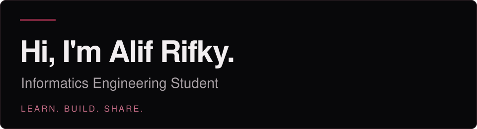

<p>
  
</p>

**Bandung, Indonesia** · Problem solving, algorithms & software development.


## About me

I'm an Informatics Engineering student who enjoys understanding how things work, solving problems step by step, and turning ideas into software.

I previously taught **C, Algorithmic Logic, and Data Structures** as an instructor. Explaining the fundamentals to others has shaped the way I learn and approach problems.

I'm currently learning **Go**, while continuing to explore web and backend development.

## Technologies I've learned & explored

A collection of languages and tools I've worked with along the way.

### Languages

<p>
  
  
  
  
  
  
  
  
</p>

### Web, backend & data

<p>
  
  
  
  
  
  
  
  
  
  
  
</p>

### Development tools

<p>
  
  
  
  
  
  
  
</p>

## Coding activity

All-time coding activity recorded through WakaTime.

<!--START_SECTION:waka-->

```txt
Total Time: 0 secs

No activity tracked
```

<!--END_SECTION:waka-->

<sub>Updated automatically via WakaTime · Includes activity recorded by connected editors.</sub>

## Contribution snake

<p>
  
</p>

<sub>Generated from my GitHub contributions · Updated every 12 hours.</sub>

## Connect

[Instagram](https://instagram.com/cptaincm) &nbsp; / &nbsp;
[LinkedIn](https://www.linkedin.com/in/alif-rifky-a16144419/) &nbsp; / &nbsp;
[Email](mailto:pratamaalifrifky@gmail.com)

---

<sub>Building, learning, and sharing — one commit at a time.</sub>
