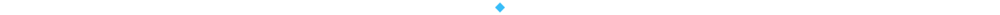

<div align="center">
  
</div>

<br />

<p align="center">
  
</p>

<p align="center">
  <a href="https://github.com/666camo?tab=repositories"></a>
  <a href="https://github.com/666camo"></a>
</p>



## 👋 About me

I'm **Alif Rifky**, a fullstack developer exploring how thoughtful interfaces and reliable backends work together. I learn by building, breaking things down, and improving one step at a time.

My current focus is **Go (Golang)**: learning its syntax, understanding interfaces, and exploring how to build HTTP services.

<table width="100%">
  <tr>
    <td width="50%" valign="top">
      <h3>🧑‍💻 Developer attributes</h3>
      <ul>
        <li><strong>Handle:</strong> 666camo</li>
        <li><strong>Class:</strong> Fullstack Developer</li>
        <li><strong>Main quest:</strong> Learn through building</li>
        <li><strong>Current quest:</strong> Go / Golang</li>
      </ul>
    </td>
    <td width="50%" valign="top">
      <h3>⚡ Developer status</h3>
      <p> </p>
      <p><strong>Next checkpoint</strong><br />Build a small HTTP API with Go.</p>
      <p><sub>Progress is measured in things understood and built.</sub></p>
    </td>
  </tr>
</table>


## 🎒 Learning inventory

Languages and tools I'm learning and exploring across the stack.

**Languages**

<p></p>

**Web, backend & data**

<p></p>

**Development tools**

<p></p>

### 🐹 Current quest: Go

```go
package main

import "fmt"

func main() {
    fmt.Println("Hello, Go. Let's build something.")
}
```

`Syntax & types` → `Structs & interfaces` → `Errors & testing` → `HTTP APIs` → `Goroutines & channels`


## 🗺️ Build roadmap

<table width="100%">
  <tr>
    <td width="50%" valign="top">
      <h3>01 / Backend systems</h3>
      <p>Explore HTTP APIs, application structure, databases, and clear error handling.</p>
      <p><code>Go</code> <code>Java / Spring</code> <code>SQL</code></p>
    </td>
    <td width="50%" valign="top">
      <h3>02 / Web experiences</h3>
      <p>Build responsive interfaces and connect them to useful backend services.</p>
      <p><code>React</code> <code>TypeScript</code> <code>Tailwind CSS</code></p>
    </td>
  </tr>
</table>

<p align="center"><a href="https://github.com/666camo?tab=repositories"><strong>Explore what I'm building →</strong></a></p>


## 📈 Quest history

<p align="center"></p>

<details>
  <summary><strong>🐍 Contribution serpent</strong></summary>
  <br />
  <picture>
    <source media="(prefers-color-scheme: dark)" srcset="https://raw.githubusercontent.com/666camo/666camo/output/github-contribution-grid-snake-dark.svg" />
    
  </picture>
</details>


<div align="center">
  <h3>💾 Save point</h3>
  <p>Learning, building, and making the next version better.</p>
  <a href="https://github.com/666camo"></a>
  <br /><br />
  <sub>Small steps. Useful builds. Continuous progress.</sub>
</div>
